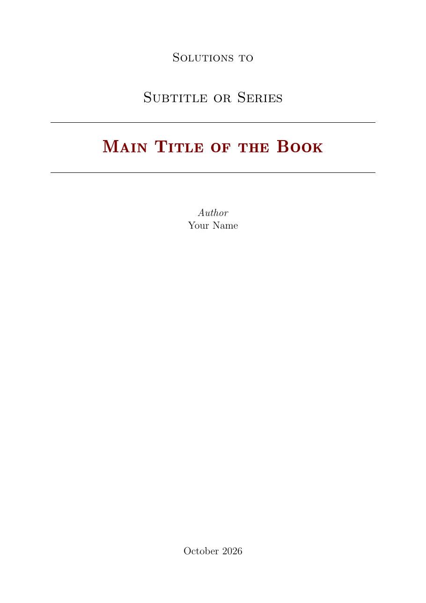
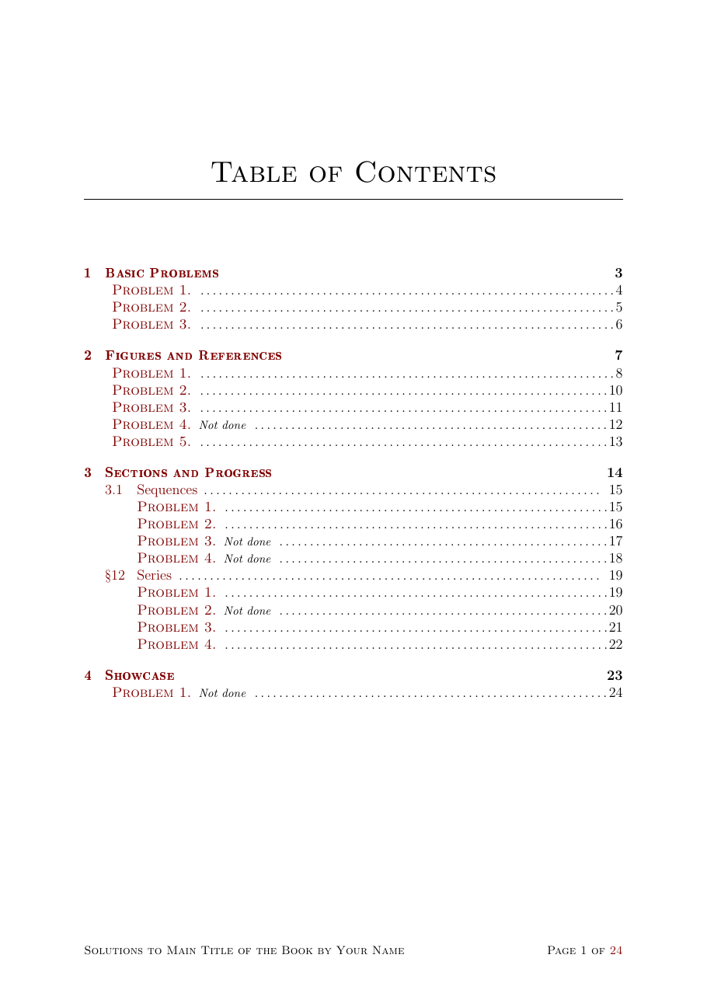
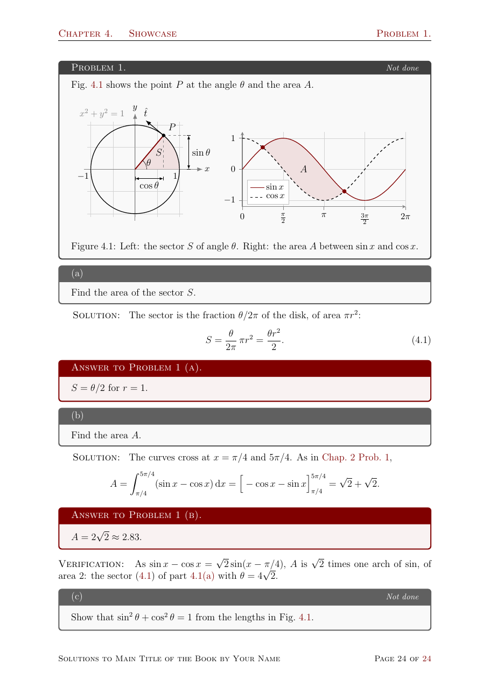

# Solution Manual Template

A LaTeX framework for writing a solution manual for any textbook or subject:
problem, solution, answer and verification sections, standalone TikZ/PGFPlots
figures, and one `latexmk` build that compiles the manual and its figures
incrementally.

The root is a minimal starter. The previews below come from the separate
[showcase project](examples/showcase/), which demonstrates the full framework.

<p align="center">
  
  
  
</p>

## Quick start

The standard setup is **Use this template**, which creates a self-contained
copy of the framework in your repository.

For Overleaf, follow [Using Overleaf](docs/overleaf.md) to start with
precompiled figures.

[](https://www.overleaf.com/docs?snip_uri=https://github.com/pobol2/Solution-Manual-Template/releases/latest/download/overleaf-starter.zip)

Prerequisites:

- **Linux:** TeX Live with pdfLaTeX, LuaLaTeX and `latexmk`, plus Perl.
- **Windows:** MiKTeX and Strawberry Perl; allow MiKTeX to install missing packages.
- **macOS:** MacTeX, including `latexmk`.

1. Click **Use this template** on GitHub to create your own repository.
2. Clone your new repository and enter its directory:

   ```sh
   git clone https://github.com/YOUR-NAME/YOUR-REPOSITORY.git
   cd YOUR-REPOSITORY
   ```

3. Set `title` and `author` in [`main.tex`](main.tex).
4. Edit the first problem in
   [`Chapters/1-First-Chapter.tex`](Chapters/1-First-Chapter.tex): its question,
   worked solution and final answer.
5. Run `latexmk` from the project root.
6. Open `main.pdf`.

To adopt future framework releases, see [Updating your copy](#updating-your-copy).

For VS Code, install the LaTeX Workshop extension. See
[Compiling](docs/customization.md#compiling) for editor builds and output
locations.

## Updating your copy

Download `solution-manual-vX.Y.Z.zip` from the
[latest GitHub release](https://github.com/pobol2/Solution-Manual-Template/releases/latest),
extract it, and replace your project's `solution-manual/` folder with the
extracted `solution-manual/` folder. Run `latexmk` from the project root and
read [`CHANGELOG.md`](CHANGELOG.md) for the changes in the release.

## Which files do I edit?

| Group | Files | Purpose |
| ----- | ----- | ------- |
| Edit regularly | [`main.tex`](main.tex), [`Chapters/`](Chapters/), [`Figures/`](Figures/) | Titles, chapter inputs, problems and figure sources. |
| Customize optionally | [`mytheme.sty`](mytheme.sty), [`mycommands.sty`](mycommands.sty), [`mypackages.sty`](mypackages.sty), [`myfigures.sty`](myfigures.sty) | Theme colors, commands, packages and figure styles. |
| Framework, never edit | [`solution-manual/`](solution-manual/) | Shared classes and build rules; customize through the project files above. |
| Generated | `build/`, `Figures/*.pdf`, `main.pdf`, `COMPLETION.md`, [edition](docs/editions.md) PDFs, `_site/` ([website](docs/website.md)) | Build outputs; run `latexmk` (and the website builder) to regenerate them. |

## Features

- [Problems and parts](docs/writing-problems.md) with solutions, answer boxes and optional verification.
- [Chapters, sections and numbering](docs/numbering-and-references.md), with textbook numbers and cross-references.
- [Standalone figures](docs/figures.md) with TikZ, PGFPlots and CSV data, rebuilt when their sources change.
- [Completion tracking](docs/completion-tracking.md), with unfinished markers, an overview and a Markdown report.
- [Editions](docs/editions.md): exercise and answer books of the same sources, built with the manual.
- [Website](docs/website.md): a static site with a catalogue of the problems and a page and a PDF per solved problem, for GitHub Pages or any host.
- [Customization](docs/customization.md) of titles, labels, layout, colors and project commands.
- [Languages](docs/customization.md#languages): English or French texts with `language=french`, with or without babel.

The [showcase project](examples/showcase/) contains the full set of examples,
and the [French example](examples/french/) a small manual in French.
See [Troubleshooting](docs/troubleshooting.md) for build problems and
[advanced submodule guide](docs/advanced-submodule.md) for submodules and migration.

## Example project

[Mechanics-Landau-Solution](https://github.com/pobol2/Mechanics-Landau-Solution)
is a real solution-manual project built on this template,
with subject-specific TikZ diagrams and numerical field tools for its figures. The template stays general:
specialized extensions like these belong in each manual's own files
(`mycommands.sty`, `myfigures.sty`, companion Lua files), not in
`solution-manual/`.

## Contributing

See [Contributing](docs/contributing.md) for running the class regression tests
with `l3build` and updating their saved results.

## Changelog

See [`CHANGELOG.md`](CHANGELOG.md) for the changes in each version.

## License

Copyright (c) 2026 P.O. Bolduc. The original framework, build scripts,
documentation and examples in this repository are licensed under the
[MIT License](LICENSE). You may reuse, modify and redistribute them, including
commercially, provided you retain the copyright and license notices.

Using this framework does not require you to license your own manual under
MIT. Choose a license for your own content and clearly identify any material
owned by others. Third-party packages and other dependencies retain their own
licenses.
